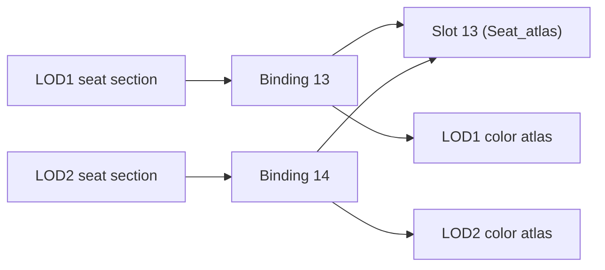

# Static AEM assets in Blender and games

The Blender add-on exports static models to experimental AEM 0.0. A model can contain several meshes and LODs, with a logical material name and optional texture paths per part. The same exported model can be placed many times in a game. [Binary format](../aem_format.md)

## Install the exporter

The add-on sources are in [tools/blender/io_export_aem](../tools/blender/io_export_aem). Blender 4.5.4 LTS was used for export and installation checks. To build an installable ZIP from the repository, run these commands from the engine root.

```sh
cd tools/blender
python -m zipfile -c io_export_aem.zip io_export_aem
```

In Blender, open **Edit → Preferences → Add-ons**, choose **Install from Disk**, and select the ZIP. Enable **Apus Engine Mesh (.aem)**. In Object Mode select the mesh objects, then use **File → Export → Apus Engine Mesh (.aem)**.

## Prepare meshes and LODs

1. Model in right-handed Z-up coordinates. Place the intended game pivot at the Blender scene origin. The exporter uses evaluated object transforms and modifiers, including mirrors, and keeps the resulting mesh placements relative to that origin.
2. Set the scene's unit scale and select **Game Units per Metre** at export. With Blender unit scale 1 and one game unit per metre, leave the export scale at 1.
3. Set the active UV layer to the one used by the base color and normal map. The first other UV layer supplies UV1. The active Point or Face Corner color attribute can supply vertex colors. The exporter triangulates the geometry. Add a Triangulate modifier before baking and exporting normal-mapped n-gons so Blender can compute tangents on the same triangles.
4. For a model with several LODs, create scene-root collections `LOD0`, `LOD1` and so on. Put the finest geometry in `LOD0` and align all levels to the same origin. Link a shared object into several collections to reuse the same mesh. Keep those collections in the active View Layer and enable **LOD Collections** in the export dialog. The export uses mesh objects within those collections and their child collections.
5. Set the numeric collection property `aem_min_screen_height` for a game-specific transition. Fractions must strictly descend, with zero for the coarsest level. For example, three levels can use `0.25`, `0.08` and `0.0`. Defaults are `0.5`, `0.25` and so on for all levels except the coarsest, which defaults to zero.

## Bake and package textures

The exporter uses the effective material assigned to each face, including object-level overrides. The Blender material name becomes the slot name. Set `aem_slot` to give several Blender materials the same game-facing name while retaining separate maps.

Add optional string properties to the material for the maps the game should resolve.

| Property | Contents |
| --- | --- |
| `aem_basecolor` | Relative path to the color map, for example `textures/seats.png` |
| `aem_normal` | Relative path to the linear tangent-space normal map |
| `aem_opacity` | Relative path to the linear cutout mask, sampled from red |

These properties are paths relative to the exported AEM directory. Use forward slashes. Ship the referenced files with the AEM and preserve that directory layout in your game's resources. The shader, cutoff, and texture objects belong to the game.

Prepare the color map as sRGB and normal and opacity maps as data. UV V is flipped during export. If the normal bake's green channel points along Blender's original increasing V, invert green in the game copy so the map follows the exported tangent basis. Preserve the original bake for editing. For the stock mesh shader, copy the opacity mask's red channel into the base color texture's alpha channel. A custom shader can sample the separate opacity texture.

## How the grandstand uses material slots

LOD0 of the Racing grandstand uses fully modeled seats. As the camera moves away, those seats give way to simpler geometry with baked textures. The LOD1 and LOD2 seat meshes each need the atlas baked for their own UVs. The game can use the same rendering settings for both, for example treating transparent pixels as gaps between the seats.

In Blender, assign a separate material to the seats in each of those LODs. Give both materials the same `aem_slot` and set `aem_basecolor` to the corresponding bake.

| Seats in Blender | `aem_slot` | `aem_basecolor` |
| --- | --- | --- |
| LOD1 | `Seat_atlas` | `textures/grandstand_basecolor.png` |
| LOD2 | `Seat_atlas` | `textures/grandstand_lod2_basecolor.png` |

For these seats, the exporter writes one **slot** named `Seat_atlas`. The game uses this name to look up its rendering settings. The exporter writes two **bindings**, each containing a reference to the same slot and the texture paths for one bake. Each mesh section points to the binding it uses.



These numbers come from the Racing grandstand export. In the example below, binding `14` gives the LOD2 texture path directly. To choose the rendering settings for that binding, look up its slot index and then the slot name.

```pascal
slotIndex:=asset.MaterialBindingSlotIndex(14); // 13
slotName:=asset.MaterialSlotName(slotIndex);   // 'Seat_atlas'
colorPath:=asset.TextureHint(14,'basecolor');  // 'textures/grandstand_lod2_basecolor.png'
```

Binding and slot indices belong to separate tables within the asset and may change when you export it again. Read the indices from the asset and use the slot name to look up settings.

## Load and draw in a game

Use `TModelAsset.LoadAEM` in scene `Load`, and call `Upload` in `InitGfx` while the graphics context is current. Share the asset between placements and give each `TModelInstance` its own transform and LOD. Free the instances before the asset, on the graphics thread while the uploaded resources are still live. [Application lifecycle](ch18_application_lifecycle.md)

This scene fragment shows the engine API with a plain material. It assumes the application has created the scene and selected its camera and projection. The types are available through `Apus.Engine.API`. Use `Apus.Engine.Scene`, `Apus.Core` and `Apus.Geom3D` for the scene type, strings and transforms.

```pascal
type
  TPropScene=class(TGameScene)
  private
    fAsset:TModelAsset;
    fInstance:TModelInstance;
    function BindPart(const part:TModelDrawPart):boolean;
  public
    procedure Load; override;
    procedure InitGfx; override;
    procedure Render; override;
    procedure ReleaseModel;
  end;

procedure TPropScene.Load;
begin
  fAsset:=TModelAsset.LoadAEM(String8('models/grandstand.aem'));
  fInstance:=TModelInstance.Create(fAsset);
  fInstance.Transform:=TMat4.Translation(5,0,0);
  inherited;
end;

procedure TPropScene.InitGfx;
begin
  inherited;
  fAsset.Upload;
end;

function TPropScene.BindPart(const part:TModelDrawPart):boolean;
begin
  shader.NormalMapOff;
  shader.TexMode(0,tblDisable,tblDisable);
  if fAsset.MaterialSlotName(part.slotIndex)='Seat_atlas' then
    shader.Material($FFFFFFFF,0)
  else
    shader.Material($FFB0A59F,0);
  result:=true;
end;

procedure TPropScene.Render;
begin
  fInstance.Draw(BindPart);
end;

procedure TPropScene.ReleaseModel;
begin
  fInstance.Free;
  fInstance:=nil;
  fAsset.Free;
  fAsset:=nil;
end;
```

Call `ReleaseModel` from the game's graphics teardown before releasing the context. Assign `fInstance.LOD:=fAsset.SelectLOD(projectedHeightFraction)` if the game uses the authored thresholds, or set a level explicitly.

## Prepare materials before the first draw

Call `CollectMaterialHints` after `LoadAEM`, for example from scene `Load`. It walks every binding in the asset, including those used in other LODs, without a graphics context or a call to `Draw`. Each entry pairs the game-facing slot name with the texture paths for that binding.

```pascal
type
  TMaterialHints=record
    slotName:String8;
    baseColorPath,normalPath,opacityPath:String8;
  end;
  TMaterialHintsArray=array of TMaterialHints;

procedure CollectMaterialHints(asset:TModelAsset;out materials:TMaterialHintsArray);
var
  bindingIndex,slotIndex:integer;
begin
  SetLength(materials,asset.MaterialBindingCount);
  for bindingIndex:=0 to High(materials) do begin
    slotIndex:=asset.MaterialBindingSlotIndex(bindingIndex);
    materials[bindingIndex].slotName:=asset.MaterialSlotName(slotIndex);
    materials[bindingIndex].baseColorPath:=asset.TextureHint(bindingIndex,'basecolor');
    materials[bindingIndex].normalPath:=asset.TextureHint(bindingIndex,'normal');
    materials[bindingIndex].opacityPath:=asset.TextureHint(bindingIndex,'opacity');
  end;
end;
```

An empty path means the binding has no hint for that texture role. Resolve each nonempty path against the logical directory of `asset.SourcePath`. Load the textures you need and store the prepared materials in a per-asset array indexed by binding.

At draw time, the engine reads the mesh section's binding and passes both indices to `TModelMaterialBinder`. For the LOD2 seats in the diagram, `part.bindingIndex` is `14`, so the binder looks up prepared material `14` to get the LOD2 atlas. If the binder needs the slot name, it can call `asset.MaterialSlotName(part.slotIndex)` directly. The engine has already looked up `part.slotIndex` from the binding.

Bind prepared color and alpha with `shader.TexMode(0,tblModulate,tblModulate)` and `shader.UseTexture`. Enable a loaded normal map with `shader.NormalMap` when the pass uses lighting. Set or clear shader and texture state for each part. Return false to skip it for the current pass. The model retains its placement while the binder runs and restores the caller's transforms after drawing. [Images and textures](ch21_resource_system.md)
